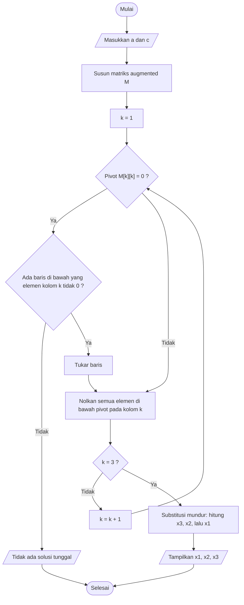

# Algoritma Eliminasi Gauss untuk Menyelesaikan SPL 3 Variabel

Nama : Ali Rafshanjani
NIM  : 202511420023
Mata kuliah : Komputasi Numerik

## 1. Latar Belakang Masalah

Sistem persamaan linear (SPL) tiga variabel adalah tiga persamaan linear yang memuat tiga bilangan yang belum diketahui, yaitu x1, x2, dan x3. Bentuk umumnya:

```
a11·x1 + a12·x2 + a13·x3 = c1
a21·x1 + a22·x2 + a23·x3 = c2
a31·x1 + a32·x2 + a33·x3 = c3
```

Algoritma ini bertugas menemukan nilai x1, x2, dan x3 yang memenuhi ketiga persamaan sekaligus.

- **Masukan:** sembilan koefisien `a` dan tiga konstanta `c`
- **Keluaran:** nilai x1, x2, x3, atau keterangan bahwa sistem tidak mempunyai solusi tunggal

## 2. Ide Dasar Metode

Eliminasi Gauss menyelesaikan SPL dengan menyederhanakannya sedikit demi sedikit sampai jawabannya mudah dibaca. Prosesnya terdiri dari dua fase:

1. **Eliminasi maju:** koefisien yang berada di bawah diagonal utama dibuat menjadi 0, sehingga sistem berbentuk tangga. Persamaan ketiga hanya memuat x3, persamaan kedua memuat x2 dan x3, sedangkan persamaan pertama masih memuat ketiganya.
2. **Substitusi mundur:** x3 dihitung lebih dulu dari persamaan ketiga. Nilainya dipakai untuk mencari x2, lalu keduanya dipakai untuk mencari x1.

Agar penulisan lebih ringkas, koefisien dan konstanta digabung dalam satu tabel yang disebut **matriks augmented** `M` (3 baris dan 4 kolom). Kolom keempat berisi konstanta `c`.

```
| a11 a12 a13 | c1 |      baris 1
| a21 a22 a23 | c2 |      baris 2
| a31 a32 a33 | c3 |      baris 3
```

## 3. Langkah-langkah Penyelesaian
 
1. Masukkan koefisien `a` dan konstanta `c`, lalu susun matriks augmented `M`.
2. Lakukan eliminasi maju untuk kolom `k = 1, 2, 3`:
   1. Periksa pivot, yaitu `M[k][k]`. Bila nilainya 0, cari baris di bawah baris `k` yang elemen kolom `k`-nya tidak 0, lalu tukar posisinya. Bila tidak ada baris yang bisa ditukar, tampilkan "tidak ada solusi tunggal" dan hentikan algoritma.
   2. Untuk setiap baris `i` di bawah baris `k`, hitung `faktor = M[i][k] / M[k][k]`, lalu kurangkan baris `i` dengan faktor kali baris `k`. Dengan cara ini `M[i][k]` menjadi 0.
3. Lakukan substitusi mundur: hitung x3 dari baris 3, kemudian x2 dari baris 2, dan terakhir x1 dari baris 1.
4. Tampilkan x1, x2, dan x3.

## 4. Pseudocode
 
```
ALGORITMA EliminasiGauss
MASUKAN  : a (koefisien 3x3), c (konstanta, 3 elemen)
KELUARAN : x1, x2, x3
 
M <- matriks augmented dari a dan c
 
// Fase 1: eliminasi maju
ULANGI untuk k = 1 sampai 3
    JIKA M[k][k] = 0 MAKA
        cari baris i > k dengan M[i][k] tidak sama dengan 0
        JIKA ada MAKA
            tukar baris k dan baris i
        SELAIN ITU
            TAMPILKAN "Tidak ada solusi tunggal"
            BERHENTI
        AKHIR JIKA
    AKHIR JIKA
 
    ULANGI untuk i = k+1 sampai 3
        faktor <- M[i][k] / M[k][k]
        ULANGI untuk j = k sampai 4
            M[i][j] <- M[i][j] - faktor * M[k][j]
        AKHIR ULANGI
    AKHIR ULANGI
AKHIR ULANGI
 
// Fase 2: substitusi mundur
x3 <- M[3][4] / M[3][3]
x2 <- (M[2][4] - M[2][3] * x3) / M[2][2]
x1 <- (M[1][4] - M[1][2] * x2 - M[1][3] * x3) / M[1][1]
 
TAMPILKAN x1, x2, x3
```

## 5. Flowchart
 


## 6. Contoh Perhitungan
 
Sistem yang akan diselesaikan:
 
```
x1 + 2·x2 +   x3 = 2
2x1 +   x2 -   x3 = 7
3x1        +   x3 = 0
```
 
Matriks augmented awal (koefisien x2 pada persamaan ketiga adalah 0):
 
```
| 1   2   1 | 2 |
| 2   1  -1 | 7 |
| 3   0   1 | 0 |
```
 
**Kolom 1** (pivot = 1):
 
- baris 2 dikurangi 2 × baris 1, hasilnya `[0, -3, -3 | 3]`
- baris 3 dikurangi 3 × baris 1, hasilnya `[0, -6, -2 | -6]`
```
| 1   2   1 |  2 |
| 0  -3  -3 |  3 |
| 0  -6  -2 | -6 |
```
 
**Kolom 2** (pivot = -3): faktor = -6 / -3 = 2
 
- baris 3 dikurangi 2 × baris 2, hasilnya `[0, 0, 4 | -12]`
```
| 1   2   1 |   2 |
| 0  -3  -3 |   3 |
| 0   0   4 | -12 |
```
 
**Substitusi mundur:**
 
```
x3 = -12 / 4                      = -3
x2 = (3 - (-3)(-3)) / (-3)        = -6 / -3 = 2
x1 = (2 - (2)(2) - (1)(-3)) / 1   = 2 - 4 + 3 = 1
```
 
Hasil: **x1 = 1, x2 = 2, x3 = -3**
 
Pengecekan pada persamaan kedua: `2(1) + 2 - (-3) = 2 + 2 + 3 = 7` (sesuai). Pada persamaan ketiga: `3(1) + (-3) = 0` (sesuai).

## 7. Catatan
 
- Eliminasi Gauss dipilih karena langkahnya berurutan dan mudah ditelusuri, serta bisa dipakai untuk SPL dengan jumlah variabel berapa pun.
- Jika sistem tidak mempunyai solusi tunggal (misalnya ada dua persamaan yang saling berkelipatan), pivot akan bernilai 0 dan tidak ada baris yang dapat ditukar, sehingga algoritma berhenti dengan pesan pada langkah 2.
- Algoritma ini diimplementasikan sebagai kode Python di Google Colab pada nomor 6.
